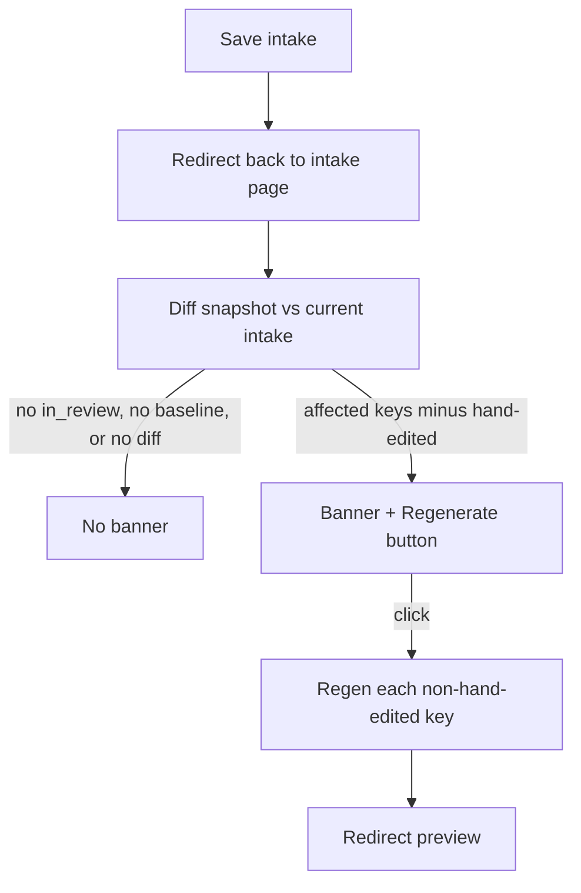

# Build plan: Selective section regen on intake update

**Status:** Implemented (including the manual per-section control — see below)
**Related:** [PHASES.md](./PHASES.md) Phase 3, [AI-SPEC.md](./AI-SPEC.md) §8–9, [TDD.md](./TDD.md)
**Last updated:** 2026-09-10

When intake is saved on a proposal that already has generated sections, diffing the previous vs new intake and mapping changed fields to affected section keys makes it possible to regenerate **only** those sections. Unrelated sections stay untouched, and so do any sections a human has hand-edited since generation.

---

## Behavior (locked)

- **Scope:** only `in_review` proposals with existing `proposal_sections` rows and a recorded generation baseline (`proposals.last_generated_intake_snapshot`). `draft`/`generating`/`needs_clarification`/`pending_approval`/`approved`/`sent` proposals are unaffected — intake saves there behave exactly as before this feature existed. `needs_clarification` proposals still require the existing full **Generate** button, which re-evaluates the whole proposal rather than a subset.
- **Trigger:** saving intake (`updateProposalIntake`) never itself calls Claude — it only persists the new fields, exactly as before. Staleness is derived live, wherever it's shown, by diffing the current intake against `last_generated_intake_snapshot` (the exact intake used the last time sections were written). This means multiple intake edits made between regenerations correctly accumulate, since the baseline is a real persisted snapshot rather than "the row right before this specific edit."
- **Confirm before regenerating:** the intake page (`src/app/proposals/[id]/intake/page.tsx`) shows a banner naming the affected sections with a **"Regenerate these sections"** button — this lives on the intake page specifically, not the hub, since that's where the driving changes are made. No AI call happens until it's clicked. Clicking it re-validates staleness fresh server-side (never trusts a client-side list) before doing anything.
- **Hand-edited sections are always skipped:** each `proposal_sections` row has `human_edited` (set `true` by the manual save paths `saveSectionHtml`/`saveSectionTitle`, and reset to `false` whenever AI writes a section, whether via full generate or this selective regen). A section with `human_edited = true` is never included in `toRegenerate`, no matter what changed — it's surfaced instead as "skipped, edited manually" in the banner so the user knows why it wasn't touched.
- **Header-only / delivery-only fields** (`clientEmail`, `title`): never trigger section regen — they don't appear in generated prose.

---

## Field → section map

Implemented in `src/lib/proposals/intake-section-map.ts` (`FIELD_TO_SECTIONS`), aligned with AI-SPEC §9:

| Changed intake field(s) | Sections to regenerate |
| --- | --- |
| `clientNeedsSummary` | `introduction` |
| `goals` | `introduction`, `proposed_solution` |
| `projectScope` | `proposed_solution` |
| `recommendedServices` | `proposed_solution`, `deliverables` |
| `proposedTimeline`, `timelinePhases` | `timeline` |
| `currency`, `proposedPrice`, `priceRange`, `pricingNotes` | `pricing` |
| `supportingMaterial` | *all six sections* — AI-SPEC describes its influence as "wherever facts belong," so it's treated conservatively rather than guessed narrowly |
| `salespersonName`, `clientName`, `companyName`, `dateOfCall` | *all six sections* — same conservative treatment; these can surface in personalized prose anywhere, not just one section |
| `clientEmail`, `title` | *(none)* |

**Diff helpers:** `diffIntake` in `intake-section-map.ts` — string equality for scalars, JSON-stable compare for `goals`, `recommendedServices`, `timelinePhases`. `sectionsAffectedByFields` unions the mapped sections and orders them per `SECTION_CATALOG`.

---

## AI: section regenerate (Phase 3 engine)

`src/lib/ai/regenerate.ts` — `regenerateSection(intake, currentSections, targetKey, instruction?)`:

- **Inputs:** full intake, all current section texts (for context/consistency), target `key`, optional instruction (default: "Update this section to reflect the latest intake changes.") and sampling `temperature` (default `0.3`). The manual per-section path (below) overrides both the instruction and temperature.
- Uses a dedicated system prompt (`REGENERATE_SECTION_SYSTEM_PROMPT` in `src/lib/ai/prompts.ts`) and a single-section Anthropic tool (`submitSectionTool` / `regenerateSectionResponseSchema` in `src/lib/ai/schema.ts`) — output is `{ key, title, content }` only.
- **Pipeline:** Markdown → sanitize → upsert, reusing `markdownToHtml` and `upsertSections` from `src/lib/proposals/generate-actions.ts`.
- Exported standalone so a future manual per-section "Regenerate" button can call the same function.

**Batch on confirm click:** sequential regen for affected keys (avoids conflicting writes, and lets later sections see earlier ones' fresh content).

**Events:**

- Per section: `section_regenerated` with `meta: { sectionKey, reason: "intake_update" }` (batch) or `meta: { sectionKey, reason: "manual" }` (single-section, below).
- The batch keeps the proposal at `in_review` throughout (`generating` only transiently while the batch runs), matching TDD's `in_review → in_review` self-loop for "Manual save or section regen."

---

## Manual per-section regenerate (implemented)

`regenerateOneSection(proposalId, sectionKey)` in `src/lib/proposals/generate-actions.ts` is a **reword/rephrase** action, not an intake-sync one — deliberately distinct from the batch flow above. It calls `regenerateSection` for exactly one section with `REWORD_SECTION_INSTRUCTION` (`src/lib/ai/prompts.ts`) and a higher `temperature` (`0.85`) so the result is noticeably different wording and sentence structure while preserving the same facts, not a near-duplicate of the current text. On demand, no staleness check, no status gate — the same precedent as `saveSectionHtml` (which is also usable regardless of proposal status). It does **not** update `proposals.last_generated_intake_snapshot`, since that's a single proposal-wide baseline and updating it here could incorrectly clear the intake page's "stale" banner for other sections that are still genuinely stale from unrelated intake changes.

UI: a "Regenerate" button (no instruction input) next to Save/Cancel on both:
- `src/components/inline-section-body.tsx` — the inline editor on `/proposals/[id]/preview`, visible while a section is open for editing; stays in edit mode afterward so the fresh draft can be reviewed/tweaked before Save/Cancel.
- `src/components/section-editor.tsx` — the per-section editor on `/proposals/[id]/edit`, next to "Save section"; calls `router.refresh()` afterward to keep the section nav list in sync.

---

## Implementation

- `src/lib/proposals/intake-section-map.ts` — `FIELD_TO_SECTIONS`, `diffIntake`, `sectionsAffectedByFields`, `getStaleSections(proposal, sections)` (pure, reused by both the hub page's display and `regenerateAffectedSections`'s own re-validation).
- `src/lib/ai/regenerate.ts` — Claude single-section regen (`regenerateSection`), shared by both the batch and manual paths.
- `src/lib/proposals/generate-actions.ts` — `regenerateAffectedSections(proposalId)` (batch) and `regenerateOneSection(proposalId, sectionKey)` (manual). `upsertSections` sets `human_edited: false` and now also returns what it persisted (`{key, title, htmlContent}[]`); `saveSectionHtml`/`saveSectionTitle` set it `true`; `generateProposal` and `regenerateAffectedSections` record `last_generated_intake_snapshot` (the manual path deliberately does not).
- `src/components/regenerate-sections-button.tsx` + intake page banner (`src/app/proposals/[id]/intake/page.tsx`) — confirm-first UI for the batch flow. `updateProposalIntake` redirects back to the intake page (not the hub) after saving, so the banner is immediately visible.
- `drizzle/0003_selective_regen.sql` — `proposals.last_generated_intake_snapshot`, `proposal_sections.human_edited`.

---

## Out of scope

- The optional free-text "instruction" input AI-SPEC §3.3 describes for manual regeneration — button-only for now.
- Any change to full-generate's behavior or the `needs_clarification` flow.
- Price XOR / min–max restructuring (separate change).
- Per-section generation baselines (each section currently shares one proposal-wide `last_generated_intake_snapshot`; see the manual-regen note above).
